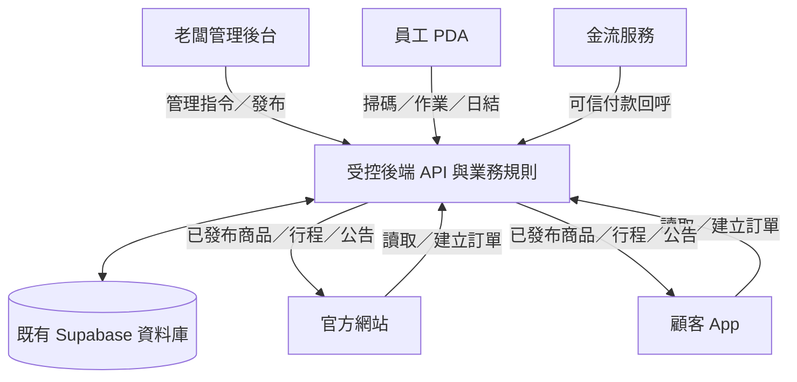

# 老爹．涼糕｜官網 × App × 老闆後台共用資料串接規格

> 文件狀態：Phase 1 設計規格／待驗收；不是資料庫 migration，也沒有修改正式資料。
> 分支：`app/phase-1-planning`
> 原則：官網持續營運，App 與後台分階段接入同一套受控資料服務。

## 1. 本次要解決的問題

同一項商品、口味、價格、訂單、會員與出攤資料，不應在官網、App、後台各自維護一份。正式系統應採「一個可信資料來源，多個依權限呈現的介面」。

- 老闆後台：管理與發布資料。
- 官網與顧客 App：讀取已發布的公開資料，建立訂單。
- 員工 PDA：依員工角色及指派工作站執行掃碼、備貨、出貨、現場銷售。
- 後端：驗證權限、價格、優惠、庫存、付款及訂單狀態；前端不得自行決定可信結果。

## 2. 系統資料流

這是邏輯資料流，不代表目前已建成 API 或已接通金流。

## 3. 資料來源與整合對照

以下是目前盤點到的既有資料表名稱與建議責任。正式開發前仍須再確認欄位、外鍵、觸發器、RLS、資料品質及實際寫入來源；不因表名相似就合併資料。

| 業務資料 | 已知既有來源 | 共用規則 |
|---|---|---|
| 涼糕口味 | `flavors` | 先沿用既有口味主檔；核對名稱、狀態、圖片、分類與價格由何處管理 |
| 一般訂單 | `orders`, `order_items` | 保留既有訂單與明細；官網/App 建單須走同一受控流程 |
| 訂單聯絡資料 | `order_customers`, `order_private` | 屬於訂單聯絡／私密資料，不等於會員 profile |
| 超商冷藏寄放訂單 | `cooling_pickup_orders`, `cooling_pickup_order_items` | 保留獨立資料與狀態，不改稱冷藏宅配 |
| 餐車排程 | `food_truck_schedules`, `food_truck_schedule_flavors` | 核對是否已支援地址、座標、發布狀態、異動紀錄與公開菜單 |
| 每日訂購設定 | `daily_order_settings`, `daily_order_regions`, `daily_order_flavors` | 保留既有每日開放、地區及口味設定語意 |
| 付款／取貨設定 | `payment_settings`, `pickup_settings` | 先確認現行官網讀取來源及設定權限；不可另造一套互相矛盾的規則 |
| 蘿蔔糕訂單 | `radish_orders`, `radish_order_items` | 保留既有蘿蔔糕訂單與品項流程 |
| 現場銷售／掃碼 | `food_truck_barcodes`, `food_truck_products`, `food_truck_sales` | PDA 接入前確認條碼、SKU、場次、庫存扣帳及日結流程 |
| 會員身份 | Supabase Auth（新整合） | Auth UID 作身份主鍵；profile 需與 UID 關聯，不把訂單聯絡資料當會員 |
| 會員優惠 | 尚待盤點／設計 | 由老闆設定規則；伺服器端計算並記錄使用結果，不硬編碼折扣 |

### 不可直接合併的資料

- `orders` 與 `cooling_pickup_orders`：可在後台統一工作清單顯示，但底層保留各自表、欄位及狀態。
- 宅配與超商冷藏寄放：配送服務、費用、交付及追蹤語意不同。
- `order_customers` 與會員 profile：前者是某張訂單的聯絡資訊，後者是登入身份。
- 商品主檔價格與某場次的現場價格：必須明確定義優先規則，不能互相覆寫。

## 4. 單一資料來源與發布規則

### 商品與口味
1. 後台編輯商品／口味資料。
2. 儲存前由後端檢查管理員權限、必填欄位及價格格式。
3. 草稿不對顧客公開；發布後官網與 App 讀取同一份已發布資料。
4. 下架不刪除歷史訂單明細；歷史訂單應保留下單當時品名、規格、單價及數量快照。
5. 場次菜單可以挑選可用口味並設定該場次售價；需清楚標示「商品預設價」與「場次售價」。

### 擺攤與餐車
1. 排程由後台建立，餐車與一般擺攤類型分開標示。
2. 只有已發布、未取消且資料完整的場次才顯示在官網/App。
3. 場次內容包含縣市、行政區、地點、完整地址、日期、開始/結束時間、當日口味與價格。
4. 異動或取消需保留異動紀錄，並依顧客通知設定發送公告。
5. 未有可靠庫存即時同步時，不顯示保證剩餘數量或保證有貨。

### 訂單
1. 官網與 App 共用同一個訂單建立服務，不各自實作一套價格計算。
2. 後端重新讀取商品、配送方式、運費規則及優惠，重新計算應付金額。
3. 建立訂單時保存商品名稱、規格、單價、數量、優惠及配送資訊快照。
4. 每筆訂單保存來源渠道，例如 website、app、staff、food_truck；實際欄位需先盤點再決定如何落地。
5. 訂單狀態轉換需定義允許的前後狀態、操作角色及時間紀錄。
6. 付款成功只由可信金流回呼或後端查證更新；管理員畫面不能直接偽造付款成功。

## 5. 會員身份與訪客結帳

- Supabase Auth 負責登入憑證、密碼重設與 session。
- 會員 profile 以 Auth UID 關聯；不得自行儲存明文密碼。
- 官網與 App 使用同一會員身份服務；登入狀態的跨平台呈現依安全 session 設計，不在網址或一般紀錄暴露 token。
- 訪客仍可免註冊下單；訪客訂單保存必要聯絡資料，但不自動建立已驗證會員身份。
- 舊訂單認領需 OTP／Email 驗證、訂單編號核對或客服審核；不能只用姓名或電話自動綁定。
- 會員只可讀取本人資料及本人訂單；客服只能在授權範圍查閱必要資料。

## 6. API 邊界（概念規格）

下列為建議服務責任名稱，不代表目前已存在的 endpoint：

| 服務責任 | 允許的主要操作 | 必要伺服器檢查 |
|---|---|---|
| 公開商品查詢 | 讀取已發布商品、分類、口味 | 只回傳公開欄位 |
| 公開行程查詢 | 讀取已發布場次與公開菜單 | 隱藏內部備註及私人資料 |
| 訪客／會員下單 | 建立購物訂單 | 重算價格、運費、優惠、可售狀態；防重複請求 |
| 訂單查詢 | 顧客查本人訂單；員工查指派訂單 | 驗證 UID、角色、工作站與資料範圍 |
| 後台商品管理 | 建立、修改、發布、下架 | 管理角色、欄位驗證、審計紀錄 |
| 後台排程管理 | 建立、異動、取消、發布場次 | 管理角色、地址與時間驗證 |
| 會員優惠驗證 | 預覽、套用、核銷 | 有效期、適用商品/場次、門檻、使用次數、防重複核銷 |
| 付款通知 | 更新付款結果 | 驗證金流簽章／交易查證及金額一致 |
| PDA 作業 | 掃碼、揀貨、出貨、現場銷售 | 員工角色、場次指派、操作冪等與庫存檢查 |

正式 endpoint、RPC、Edge Function 或資料表名稱，須在現有程式與資料庫流程盤點後決定，不先憑空建立。

## 7. 同步、衝突與故障處理

- 後台發布才更新顧客端可見內容；草稿與內部備註不得外洩。
- 價格、優惠、庫存與付款以伺服器端資料為準，前端快取不可當最終依據。
- PDA 離線時只允許明確核准的離線工作；恢復連線後以唯一操作 ID 去重，避免重複扣庫存或重複建立銷售單。
- 同一筆資料同時被修改時，採版本號／更新時間檢查並提示衝突；不靜默覆蓋較新的資料。
- API 暫時失效時，官網原有購物流程先保持不變；切換前需有回復方案。
- 推播失敗不應回滾已成功保存的排程；需保留待重送狀態與發送紀錄。

## 8. 資安與正式資料保護門檻

目前已盤點到的風險需在任何正式串接前處理與驗證：

1. `merch_backend_sync` 曾被 Advisor 標示 RLS disabled；先查明同步用途、呼叫者與最小權限設計，不可直接開 RLS 後假設已修好。
2. 部分 merch 資料表曾出現 authenticated 可廣泛寫入的 policy；須檢查 permissive policy 的 OR 組合與實際管理角色。
3. SECURITY DEFINER 函式需逐一檢查函式內容、權限判斷、search_path 與 EXECUTE 權限；Advisor 警示需核實，不可只憑名稱判斷。
4. 檢查 Auth 密碼外洩保護、Storage RLS、Data API grants/exposure、付款 webhook。
5. 角色資訊不能取自可由使用者自行修改的 user_metadata；`TO authenticated` 也不等於完成授權。
6. service_role／secret key 絕不可放在瀏覽器、App 或 PDA。
7. 既有官網與正式資料庫未經明確授權，不執行 DDL、DML、RLS、Auth 或 Storage 變更。

## 9. 分階段串接順序

| 次序 | 工作 | 完成判定 |
|---|---|---|
| 1 | 現有官網程式呼叫資料來源盤點 | 每個頁面讀寫的表、RPC、付款及通知來源有清單 |
| 2 | Supabase schema／RLS／function 安全盤點 | 權限矩陣、風險清單及測試案例完成 |
| 3 | 商品與口味唯讀共用服務 | 官網與 App 顯示一致，草稿/下架不洩漏 |
| 4 | 擺攤／餐車唯讀共用服務 | 篩選、場次菜單、價格、異動狀態一致 |
| 5 | 共用會員登入與 profile | 官網/App 同一身份，會員資料隔離 |
| 6 | 共用訂單建立與查詢 | 訪客與會員下單成功，價格由後端重算 |
| 7 | 老闆後台寫入與發布 | 權限、審計、衝突與回復測試通過 |
| 8 | PDA 接入 | 等設備型號與掃碼方式確認後進行 |

## 10. 上線前驗收測試

- [ ] 後台修改商品並發布後，官網與 App 顯示相同資料。
- [ ] 草稿、下架商品與內部備註不會出現在公開頁面。
- [ ] 商品預設價格與場次價格規則明確，歷史訂單金額不會被新價格改寫。
- [ ] 訪客不註冊也能完成允許的購物流程。
- [ ] 會員在官網與 App 使用同一身份，不能讀取其他會員訂單。
- [ ] 舊訂單不能僅憑姓名／電話被錯誤認領。
- [ ] 宅配與超商冷藏寄放仍走各自原有流程。
- [ ] 後端拒絕被竄改的價格、運費、折扣與付款狀態。
- [ ] 排程異動後，官網/App 狀態一致，通知有發送紀錄。
- [ ] 員工無法存取未指派工作站或場次資料。
- [ ] 重複請求／重複掃碼不會產生重複訂單或重複扣庫存。
- [ ] 切換失敗時可回復原官網流程。

## 11. 本文件不授權的事項

本文件只定義整合規則與驗收標準，不授權修改正式 Supabase 專案、現有官網程式、付款設定、會員資料、RLS policies 或正式訂單。任何正式環境變更須先提出具體變更項目、影響範圍、備份與回復方案，再取得明確同意。
